<div align="center">

# Liquidum

**An iOS 26-style glass tab bar for Flutter.**
It looks and moves like the native iOS 26 bar, and it takes a few lines to use.

Open source under the [MIT License](LICENSE).

Liquidum is an independent project, not affiliated with or endorsed by Apple Inc.

[](https://pub.dev/packages/liquidum)


[](LICENSE)

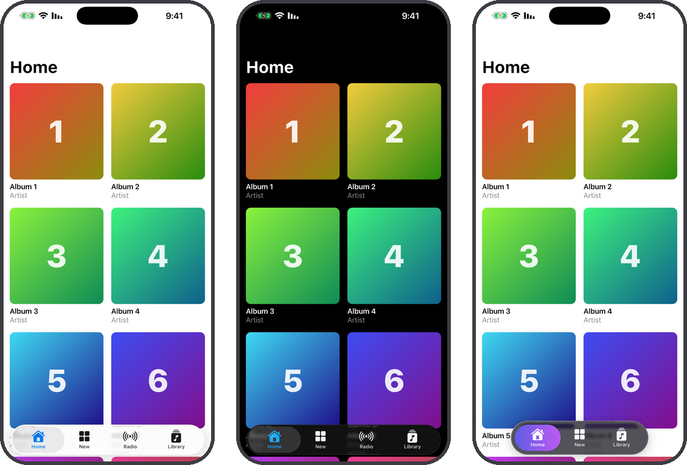

</div>

## Why Liquidum

- **Measured, not imitated.** Every part of the glass was rebuilt from
  Apple's own bar in the iOS 26.5 simulator: refraction, frost, dispersion,
  rim light, shadows, the lens and its springs, and the colors over light and
  dark content. Each was checked side by side with UIKit.
- **One widget.** `GlassTabScaffold` gives you the bar, the pages, the
  navigation and the iOS behaviour. You describe the tabs.
- **Adapts like iOS.** The glass reads what is under it and turns light or
  dark at UIKit's thresholds, and its colors follow the content.
- **Yours to style.** Colors, badges, gradients, shadows, padding and fonts.
  You can use iOS's own tint model or paint your design's colors exactly.
- **Right to left.** In Arabic, Hebrew and other right-to-left apps, the tabs
  are mirrored as UIKit mirrors them.

## Install

```sh
flutter pub add liquidum
```

## Quick start

```dart
import 'package:flutter/cupertino.dart';
import 'package:liquidum/liquidum.dart';

void main() => runApp(
  const CupertinoApp(
    home: GlassTabScaffold(
      tabs: [
        GlassTab(icon: CupertinoIcons.house_fill, label: 'Home', page: HomePage()),
        GlassTab(icon: CupertinoIcons.search, label: 'Search', page: SearchPage()),
        GlassTab(icon: CupertinoIcons.bell_fill, label: 'Alerts', badge: '3', page: AlertsPage()),
      ],
    ),
  ),
);
```

It works the same inside a `MaterialApp`.

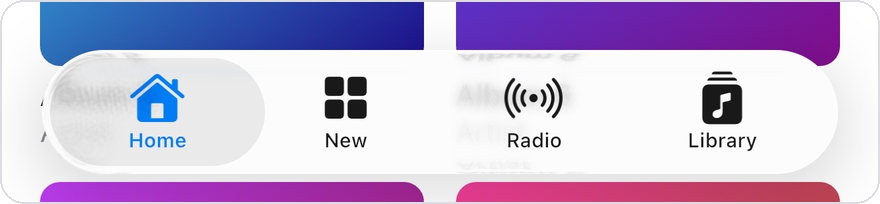

### What the scaffold does for you

- **The bar floats over your pages**, and its glass adapts to what scrolls
  under it.
- **The bar sizes itself the way UIKit's does.** With up to three tabs it is
  only as wide as they need, and centered. With four or more it spans the
  screen.
- **Each tab keeps its page.** Scroll position and state survive switching.
- **Each tab has its own navigator.** `Navigator.push` stays inside the tab,
  under the bar, and the back button pops it first.
- **Tapping the selected tab again** returns to its first page.
- **Your pages see the bar** in `MediaQuery.padding`, so a `SafeArea` or a
  scroll view keeps the last item clear of it.
- **To switch tabs from code**, use `GlassTabScaffold.of(context).index = 1`,
  or pass a `GlassTabController`.

## Press and slide

Press anywhere on the bar and the selection lifts into a clear lens that
follows your finger exactly. Slide it across the tabs, then let go to select
the tab under it. The tabs under the lens are magnified and refracted through
it, and the bar swells, glows and washes under your finger, as in iOS.

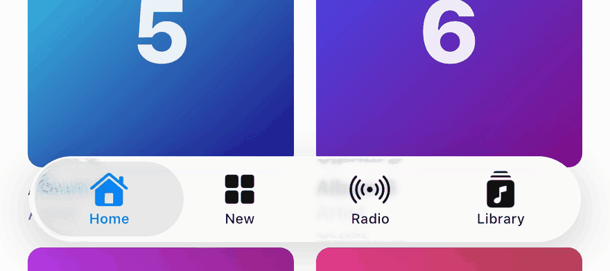

## Customize

Every option is optional and defaults to UIKit's look.

### Colors and badges

```dart
GlassTabScaffold(
  selectedColor: CupertinoColors.systemPink,
  tabs: [
    GlassTab(icon: CupertinoIcons.house_fill, label: 'Home', page: HomePage()),
    GlassTab(icon: CupertinoIcons.bell_fill, label: 'Alerts', badge: '3', page: AlertsPage()),
  ],
)
```

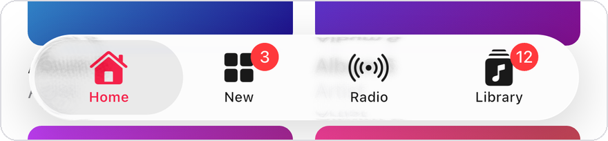

The selected color is mixed with the glass below it, as `UITabBar.tintColor`
is. The other tabs take their colors from the glass, as in iOS 26. Set
`unselectedColor` to override them; UIKit itself can't do that.

### Glass colors, at rest and in motion

The glass under the selected tab and the lens it lifts into while you drag
can each have their own color.

```dart
GlassTabScaffold(
  selectedColor: CupertinoColors.systemIndigo,
  indicatorColor: Color(0x4D5E5CE6), // the selection at rest
  lensColor: Color(0x99FF2D55),      // the lens, while it moves
  tabs: [...],
)
```

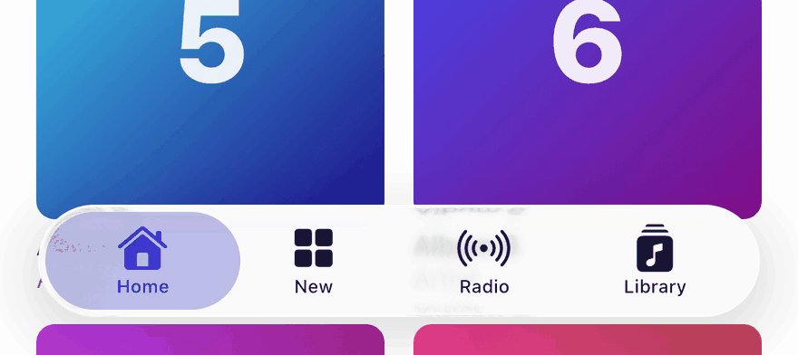

`glassColor` colors the whole bar the same way. The color's alpha sets how
strongly it shows.

### Decorations: gradients and shadows

`glass`, `indicator` and `lens` decorate the three pieces of glass: the bar,
the selection at rest, and the lens while it moves. Each takes a
`GlassDecoration`, which works like a `BoxDecoration`.

```dart
GlassTabScaffold(
  brightness: Brightness.dark,
  adaptive: false,
  barPadding: EdgeInsets.all(8),
  glass: GlassDecoration(
    color: Color(0xC21C1C24),
    fill: GlassFill.paint,
    shadows: [BoxShadow(color: Color(0x33000000), offset: Offset(0, 4), blurRadius: 16)],
    innerShadows: [BoxShadow(color: Color(0x33FFFFFF), blurRadius: 1, spreadRadius: 1)],
  ),
  indicator: GlassDecoration(
    gradient: LinearGradient(colors: [Color(0xFF5E5CE6), Color(0xFFBF5AF2)]),
    fill: GlassFill.paint,
  ),
  tabs: [...],
)
```

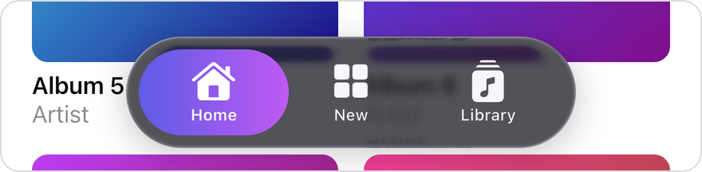

There are two ways to fill the glass:
- **`GlassFill.tint`**, the default, colors the glass the way iOS does
  (`UIGlassEffect.tintColor`). The color is true over white glass and
  deeper over dark glass.
- **`GlassFill.paint`** lays the color over the blur exactly as given, the way
  a design tool does. Use it to match a brand's colors exactly.

Drop shadows are drawn around the glass, not under it. Inner shadows work
like inset shadows.

### Right to left

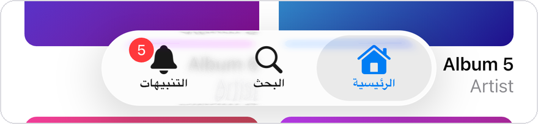

Nothing to set: in a right-to-left `Directionality` the first tab sits on the
right, and badges move to the icon's other side.

### Search tab, accessory and minimizing

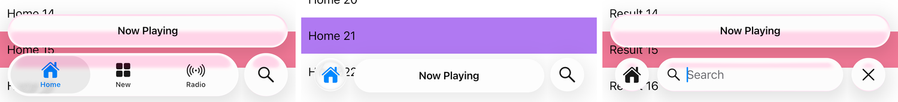

iOS 26's extras, each one line:

```dart
GlassTabScaffold(
  minimizeOnScroll: true,              // collapse as a page scrolls down
  accessory: Text('Now Playing'),      // a glass capsule above the bar
  tabs: [
    GlassTab(icon: CupertinoIcons.house_fill, label: 'Home', page: HomePage()),
    GlassTab(icon: CupertinoIcons.music_note, label: 'Radio', page: RadioPage()),
    GlassTab.search(                   // its own circle at the end
      controller: searchText,          // and a search field when selected
      page: SearchPage(searchText),
    ),
  ],
)
```

- **`GlassTab.search`** works like UIKit's `UISearchTab`: a glass circle at
  the bar's trailing end. While it is selected, its icon takes the selected color and
  the bar shows no selection.
- **With a `controller`**, selecting it opens the bar into a search field, as
  UIKit's does when the search page has a search controller:
  - the other tabs collapse into a circle with the last tab's icon, and a
    tap on the circle goes back;
  - while the field has the keyboard, it narrows for a close button and rides
    above the keyboard;
  - the close button clears the field and ends the editing.

  The field's text is the controller's, and `onChanged` and `onSubmitted`
  report it.
- **`accessory`** works like UIKit's bottom accessory: a 48pt capsule 8pt
  above the bar, as wide as it. Its content is drawn as you give it, and takes taps.
- **`minimizeOnScroll`** works like UIKit's
  `tabBarMinimizeBehavior = .onScrollDown`.
  Scrolling down collapses the bar into a circle with the selected tab's
  icon, and the accessory moves beside it. Scrolling up, or a tap on the
  circle, expands it again. As in UIKit, the tabs blur and fade where they
  are while the glass shrinks over them, and the selected icon slides into
  the circle. The motion uses UIKit's springs, measured frame by frame.

### Accessibility

The bar follows iOS's **Increase Contrast** and **Reduce Motion** by itself:

- With Increase Contrast, the glass is filled nearly white, the tabs are
  drawn in their colors as they are, and the selected color darkens the way
  UIKit's does (the system blue turns `#1E6EF4`).
- With Reduce Motion, the selection slides under the finger without lifting
  into a lens, and nothing swells or flexes.

**Reduce Transparency** makes the glass nearly opaque, with no refraction.
Flutter does not report that setting, so pass it in with
`reduceTransparency: true`, for example from a platform channel that reads
`UIAccessibility.isReduceTransparencyEnabled`.

### All options

| On `GlassTab` | |
|---|---|
| `icon`, `selectedIcon` | `IconData`, or any widget with `GlassTab.custom` (SVG, image). The bar uses the icon's shape and colors it. Set `tintIcon: false` to keep its own colors, for example for a profile photo |
| `label` | shown under the icon, and read by screen readers |
| `badge` | a count or short word on the icon |
| `color` | this tab's selected color |
| `page` | the tab's first page |
| `GlassTab.search(page:)` | a search tab, in its own circle at the bar's end; with `controller` (and `placeholder`, `onChanged`, `onSubmitted`), it opens into a search field |

| On `GlassTabScaffold` | |
|---|---|
| `selectedColor` | the selected tab's color; the system blue by default |
| `unselectedColor` | the other tabs' color; by default they take their color from the glass |
| `badgeColor` | the system red by default |
| `glassColor`, `indicatorColor`, `lensColor` | shorthands that tint the bar, the selection at rest, and the lens |
| `glass`, `indicator`, `lens` | `GlassDecoration`: color or gradient, fill, shadows, inner shadows |
| `brightness`, `adaptive` | force light or dark glass; whether it adapts to the content |
| `labelStyle` | merged into the labels' style, for example a font family |
| `barPadding` | space inside the bar around the tabs; the bar grows with it (UIKit: 4pt) |
| `barMargin` | the bar's distance from the screen's sides and bottom (UIKit: 21pt) |
| `backgroundColor` | painted behind the pages |
| `accessory` | a widget in a glass capsule above the bar |
| `minimizeOnScroll` | collapse the bar as a page scrolls down |
| `reduceTransparency` | draw the glass as iOS's Reduce Transparency does |
| `initialIndex`, `onTabChanged`, `controller` | the selected tab |

## Built against UIKit, stage by stage

Liquidum was built in six stages, and each was checked against Apple's bar
before the next one started:
- **Same conditions:** the same screen, background and touches for both bars.
- **Glass:** UIKit's own layers and filters were read in the simulator.
- **Comparison:** recordings were compared frame by frame.

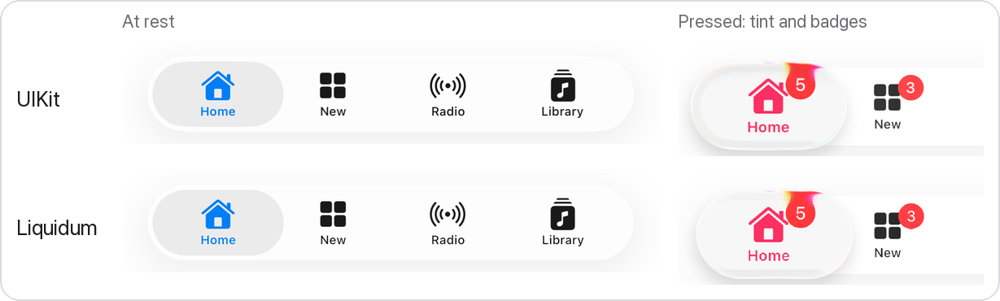

<table>
<tr>
<td width="50%" valign="top">

**1 · Controller and glass field**

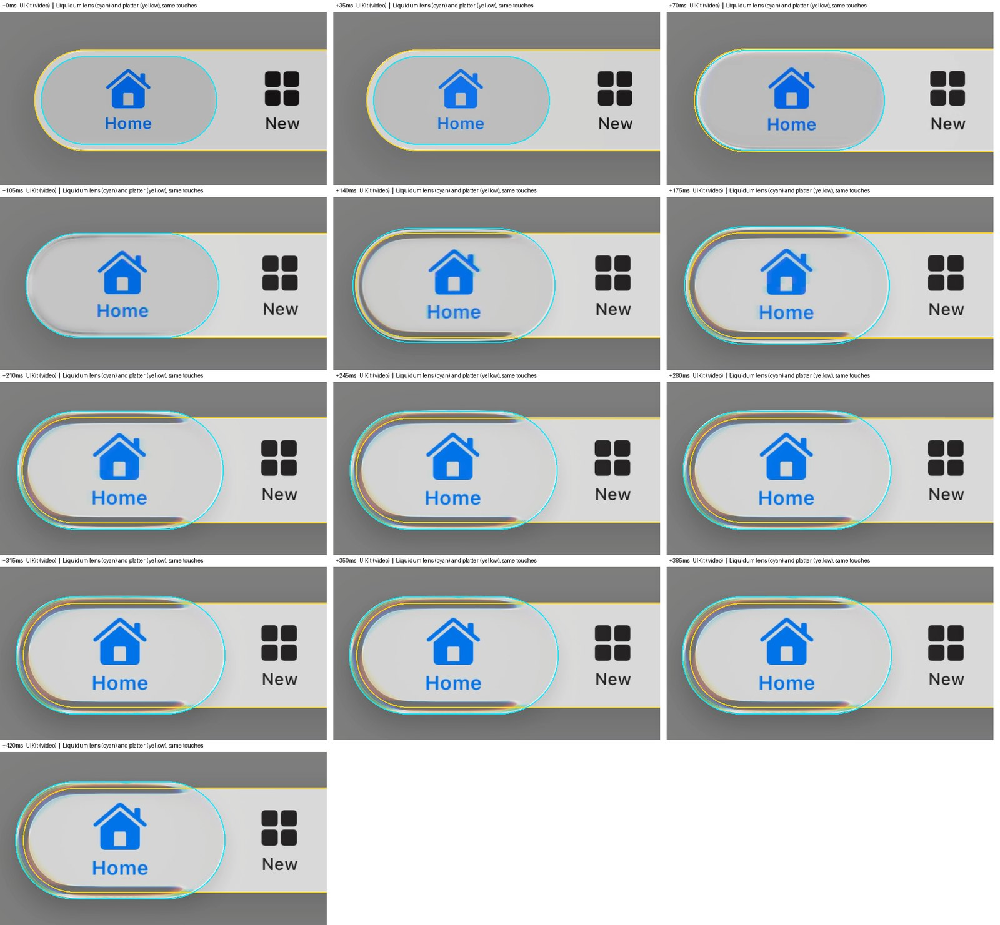

<sub>The lens lifting under a press, frame by frame. This is UIKit's
recording, with Liquidum's lens (cyan) and bar (yellow) outlined on it, from
the same touches.</sub>

</td>
<td width="50%" valign="top">

**2 · One shared backdrop**

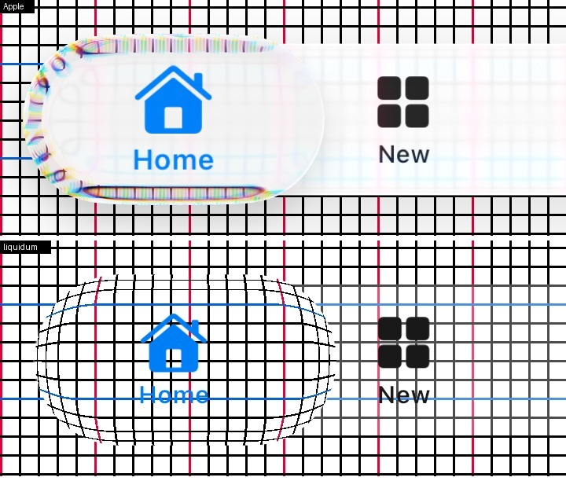

<sub>The bar and the lens read the content behind them from one capture. So
the lens can bend content from past its own edge without seeing the bar's
glass. Apple's is on top. Below is Liquidum's, whose optics were still
placeholders at this stage.</sub>

</td>
</tr>
<tr>
<td width="50%" valign="top">

**3 · Optics**

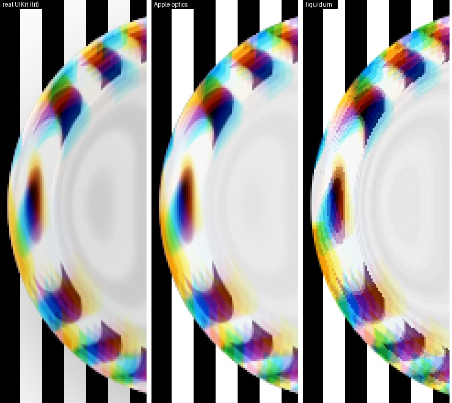

<sub>Refraction and dispersion at the lens's end over stripes, zoomed 3×.
From left: UIKit, UIKit's optics rebuilt on their own, Liquidum.</sub>

</td>
<td width="50%" valign="top">

**4 · Lifted content**

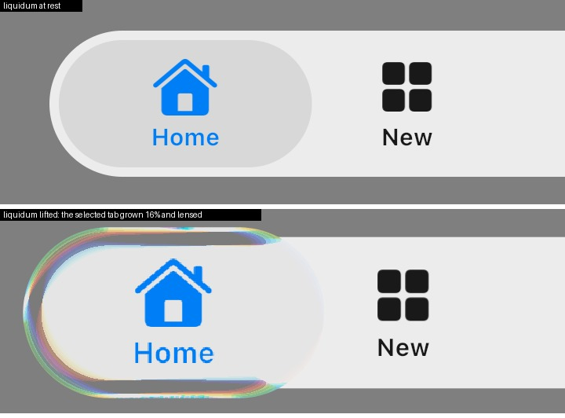

<sub>When the lens lifts, the selected tab grows 16% and is lensed through
it, as in UIKit.</sub>

</td>
</tr>
<tr>
<td width="50%" valign="top">

**5 · Lighting**

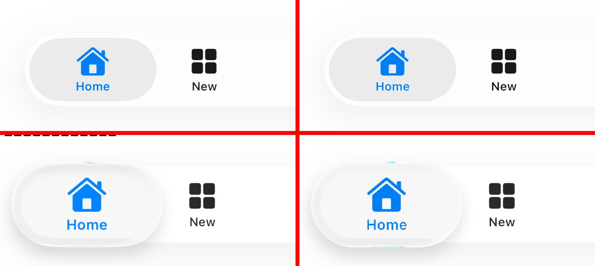

<sub>Rim light, shadows, and the glow under the finger. UIKit is on the left
and Liquidum on the right, at rest on top and lifted below.</sub>

</td>
<td width="50%" valign="top">

**6 · Adaptive appearance**

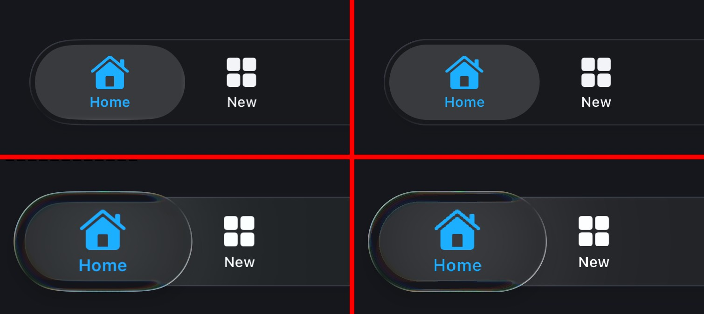

<sub>Over dark content the bar turns dark at UIKit's thresholds, and its
colors follow the content. UIKit is on the left and Liquidum on the
right.</sub>

</td>
</tr>
</table>

<p align="center">
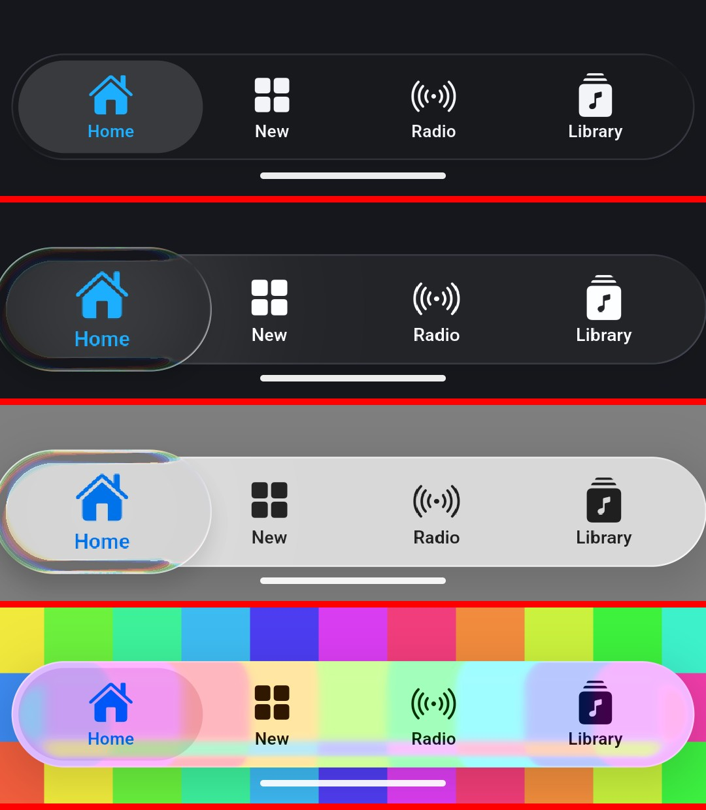<br>
<sub>The same bar on Android, with Impeller on OpenGL ES.</sub>
</p>

At rest the two bars differ by about one level out of 255 on average, mostly
at the edges of letters. Each stage's measurements, method and remaining
differences are in [`doc/comparison`](doc/comparison).

Since then, the same way:
- **The frost** is a real blur, drawn once, then refracted, as UIKit does it.
  The ghosting behind fine lines is gone, and the bar's edges are closer to
  UIKit's.
- **The lens** has UIKit's darker band inside its top edge.
- **New:** the search tab, the accessory, minimizing, and the accessibility
  settings, each measured from UIKit.

The numbers are in [`doc/comparison/refinements`](doc/comparison/refinements).

## Going further

- **`GlassTabBar`** is the bar on its own, for apps that manage their own
  pages or use a router such as go_router's `StatefulShellRoute`. It takes
  `items`, `selectedIndex` and `onSelected`, and the same styling options,
  with `padding` in place of `barPadding`. You place it yourself, so it has no
  margin.
- **`GlassBackdrop`** wraps the content that glass floats over. The bar
  measures it to adapt; the scaffold adds one for you.
- **`Glass`** is UIKit's glass (`UIGlassEffect`) behind any widget: the
  same material as the bar, at any size, in a capsule or with rounded
  corners. `style: GlassStyle.clear` makes the clearer glass for rich
  content, `tint` tints it, and `brightness` forces light or dark. Up to
  64pt tall it turns light or dark with what is behind it, as UIKit's does;
  larger glass follows the system.

```dart
Glass(
  radius: 20, // a capsule by default
  child: Padding(padding: EdgeInsets.all(16), child: Text('Liquid glass')),
)
```

  It was rebuilt from UIKit's own inputs at 30 to 400pt and compared with
  `UIGlassEffect` over the same backgrounds: see
  [`doc/comparison/glass-widgets/stage1`](doc/comparison/glass-widgets/stage1).

## Examples

The [`example`](example) folder holds four apps. Run them from it.

| | |
|---|---|
| `flutter run` | the scaffold with four tabs, about 40 lines |
| `flutter run -t lib/playground.dart` | change colors, badges, appearance and direction live, and turn on the search tab, the accessory, minimizing on scroll and Reduce Transparency. On iOS, a switch swaps in Apple's own tab bar over the same content to compare them |
| `flutter run -t lib/features.dart` | a search tab that opens into a field, an accessory, and the bar minimizing as you scroll |
| `flutter run -t lib/comparison.dart` | the harness used to compare with UIKit |

Judge motion in profile or release mode: debug builds are much slower.

## Requirements and limits

- **Impeller is required** (`ImageFilter.shader`), on iOS and on Android.
  Other renderers get a plain frosted bar.
- **Paint glass after the content it floats over**, for example later in a
  `Stack`; the scaffold does this.
- **Don't wrap glass in an `Opacity`, a `ShaderMask` or another save layer.**
  It has to paint into the root layer.
- **Keep tab icons static.** The bar draws its tabs from an image of them,
  rendered again whenever they repaint. A `RepaintBoundary` inside an icon
  hides its repaints from the bar.
- **Reduce Transparency has to be passed in** (see Accessibility): Flutter
  does not report it.
- **No scroll-edge effect**, because UIKit's iOS 26.5 tab bar shows none: content
  scrolling under it is only frosted by the glass and darkened by its shadow.
- **Not done yet:** light that follows the device's tilt.

## License

Liquidum is open source under the [MIT License](LICENSE): free to use, in
personal and commercial apps alike.

Liquidum is an independent project, not affiliated with or endorsed by Apple
Inc. Apple, iOS and UIKit are trademarks of their respective owners.
