<div align="center">

# Liquidum

**Apple's Liquid Glass for Flutter, rebuilt from UIKit and measured against it.**

Glass, buttons, switches, sliders, tab bars, navigation bars, menus, sheets,
alerts and popovers that look and move like iOS 26's own.

[](https://pub.dev/packages/liquidum)
[](https://pub.dev/packages/liquidum/score)
[](https://pub.dev/packages/liquidum/score)


[](LICENSE)

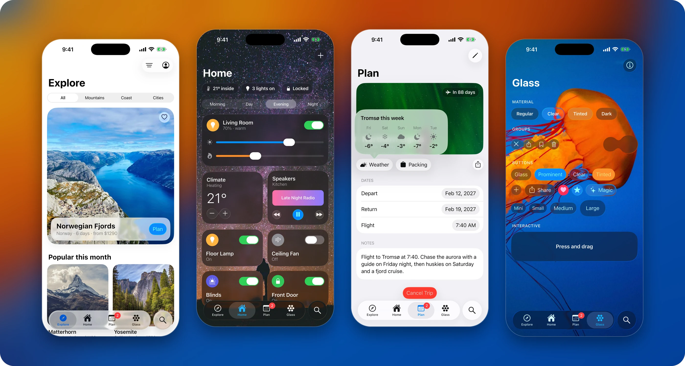

</div>

## Contents

- [Why Liquidum](#why-liquidum)
- [Install](#install) and [quick start](#quick-start)
- [The widgets](#the-widgets)
  - [Glass](#glass) · [Buttons](#buttons) · [Controls](#controls)
  - [Tab bar](#tab-bar) · [Navigation bars and toolbars](#navigation-bars-and-toolbars)
  - [Menus](#menus) · [Date picker and edit menu](#date-picker-and-edit-menu)
  - [Sheets, alerts and popovers](#sheets-alerts-and-popovers)
- [Measured against UIKit](#measured-against-uikit)
- [Platforms](#platforms) · [Accessibility](#accessibility)
- [Examples](#examples) · [Requirements and limits](#requirements-and-limits)

## Why Liquidum

- **Measured, not imitated.** Every widget was rebuilt from UIKit's own
  layers, filters and springs, read in the iOS 26.5 simulator. Each one was
  then compared with UIKit, side by side and frame by frame, before the
  next was started.
- **One material everywhere.** Buttons, controls, bars, menus and sheets
  are all the same glass, at the sizes and with the inputs UIKit gives
  each. It bends the content behind it, adapts to it, and melts into
  neighboring glass.
- **It moves like iOS.** Menus grow out of their buttons with UIKit's
  liquid morph. Presses swell the glass and make it glow. Lenses lift under
  the finger. Every motion uses UIKit's springs.
- **Light and dark, by itself.** Glass follows the system appearance. Small
  glass also turns light or dark with what is behind it, at UIKit's
  thresholds.
- **A small API.** One widget or one function per UIKit control, with
  flat, optional parameters that default to UIKit's look.

<p align="center">
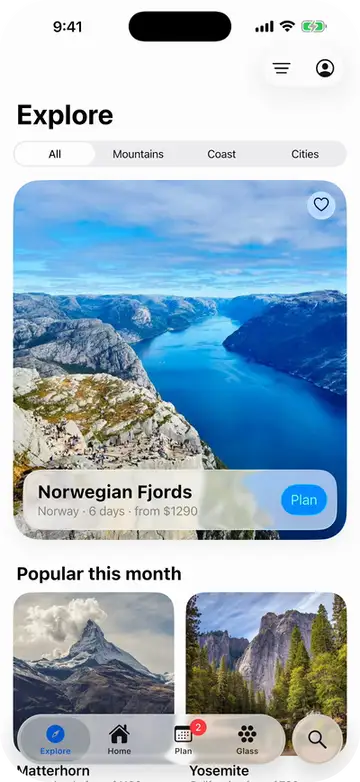<br>
<sub>The showcase app, recorded on the iOS simulator: a menu and a context menu morph out of their glass, the tab bar's lens slides across, then a popover and a sheet.</sub>
</p>

## Install

```sh
flutter pub add liquidum
```

Liquidum needs Flutter 3.47 or later, with Impeller (the default on iOS and
Android).

## Quick start

A tab bar of glass over your pages:

```dart
import 'package:flutter/cupertino.dart';
import 'package:liquidum/liquidum.dart';

void main() => runApp(
  const CupertinoApp(
    home: GlassTabScaffold(
      tabs: [
        GlassTab(icon: CupertinoIcons.house_fill, label: 'Home', page: HomePage()),
        GlassTab(icon: CupertinoIcons.search, label: 'Search', page: SearchPage()),
        GlassTab(icon: CupertinoIcons.bell_fill, label: 'Alerts', badge: '3', page: AlertsPage()),
      ],
    ),
  ),
);
```

Then glass anywhere, over anything:

```dart
Stack(
  children: [
    Image.asset('photo.jpg'),
    Glass(
      radius: 24,
      child: Padding(padding: EdgeInsets.all(16), child: Text('Liquid glass')),
    ),
    GlassButton(label: 'Done', prominent: true, onPressed: save),
  ],
)
```

The scaffold works the same inside a `MaterialApp`.

## The widgets

Every widget is UIKit's iOS 26 control, rebuilt and measured on iOS 26.5:

| Liquidum | UIKit | What it is |
|---|---|---|
| [`Glass`](#glass) | `UIGlassEffect` | The material, behind any widget: regular or clear, tinted, interactive |
| [`GlassGroup`](#glass) | `UIGlassContainerEffect` | Glass that melts together where it comes close |
| [`GlassButton`](#buttons) | `UIButton.Configuration.glass()` | Glass, prominent and clear buttons in four sizes, optionally with a menu |
| [`GlassSwitch`](#controls) | `UISwitch` | A switch whose thumb lifts into a liquid lens |
| [`GlassSlider`](#controls) | `UISlider` | A slider whose thumb lifts into a liquid lens |
| [`GlassSegmentedControl`](#controls) | `UISegmentedControl` | Segments with a selection of glass that slides |
| [`GlassTabScaffold`](#tab-bar), `GlassTab` | `UITabBarController` | The floating tab bar with its pages, its lens and a search tab |
| [`GlassTabBar`](#tab-bar), `GlassTabItem` | `UITabBar` | The tab bar on its own, for your own navigation |
| [`GlassPage`](#navigation-bars-and-toolbars), `GlassBarItem` | `UINavigationBar`, `UIToolbar` | Bars of glass over a page, with a large title and UIKit's scroll-edge effect |
| [`GlassMenuItem`](#menus) | `UIMenu` | Pull-down menus from buttons and bar items, with submenus |
| [`GlassContextMenu`](#menus) | `UIContextMenuInteraction` | Hold a view to lift it and open its menu |
| [`GlassEditMenu`](#date-picker-and-edit-menu) | `UIEditMenuInteraction` | The edit menu over a text selection |
| [`GlassDatePicker`](#date-picker-and-edit-menu) | `UIDatePicker` (`.compact`) | A compact date picker that opens a calendar or time wheels on glass |
| [`showGlassSheet`](#sheets-alerts-and-popovers) | `UISheetPresentationController` | A sheet with detents, glass below the large one |
| [`showGlassAlert`](#sheets-alerts-and-popovers) | `UIAlertController` (`.alert`) | An alert with actions and text fields |
| [`showGlassActionSheet`](#sheets-alerts-and-popovers) | `UIAlertController` (`.actionSheet`) | An action sheet, or a popover when it has a source |
| [`showGlassPopover`](#sheets-alerts-and-popovers) | `UIPopoverPresentationController` | A popover whose arrow points at its source |

Also exported: `GlassBackdrop` (wraps the content glass floats over, for
adaptive appearance), `GlassBrightness` (builds content that turns light or
dark with the glass under it), `GlassTabController`, and the tab bar's
`GlassDecoration` and `GlassFill`.

### Glass

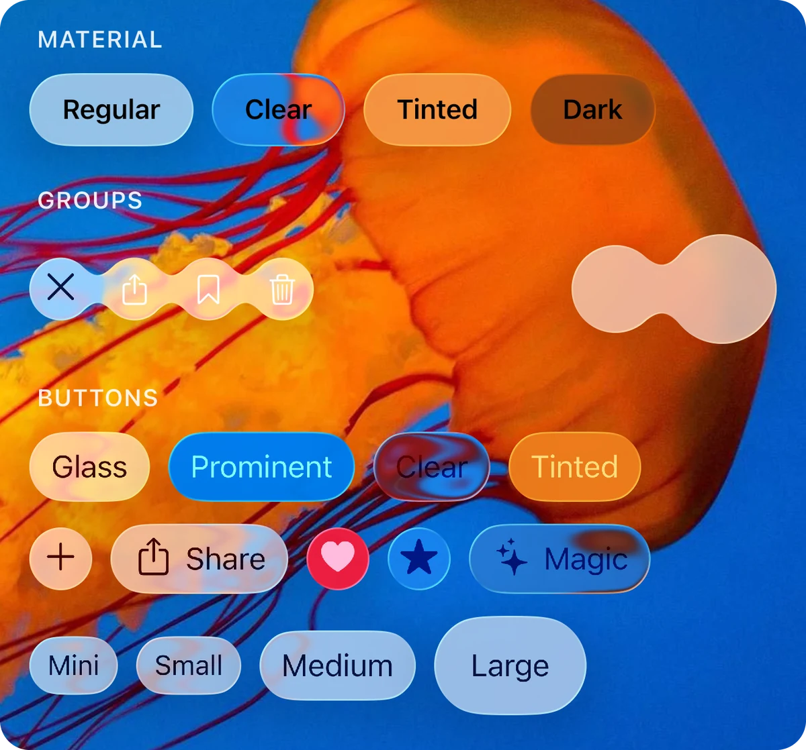

`Glass` is UIKit's glass behind any widget, from 30 to 400pt, in a capsule
or with Apple's continuous corners. It refracts what is behind it, frosts
it, and lights its rim, with the inputs UIKit gives each size.

```dart
Glass(child: label)                                   // regular, a capsule
Glass(radius: 28, child: panel)                       // rounded corners
Glass(style: GlassStyle.clear, child: label)          // for rich content
Glass(tint: Color(0xB3FF8D28), child: label)          // tinted, as tintColor
Glass(interactive: true, child: tile)                 // swells and glows when pressed
Glass(visible: shown, child: label)                   // materializes and dematerializes
```

`GlassGroup` draws the glass inside it as one glass. Shapes melt together
where they come within `spacing` of each other, with UIKit's neck between
them. Glass that appears grows out of its neighbors.

```dart
GlassGroup(
  spacing: 20,
  child: Row(children: [
    GlassButton(icon: CupertinoIcons.ellipsis, onPressed: toggle),
    SizedBox(width: 6),
    Glass(visible: expanded, child: SizedBox.square(dimension: 34, child: Icon(CupertinoIcons.share))),
  ]),
)
```

### Buttons

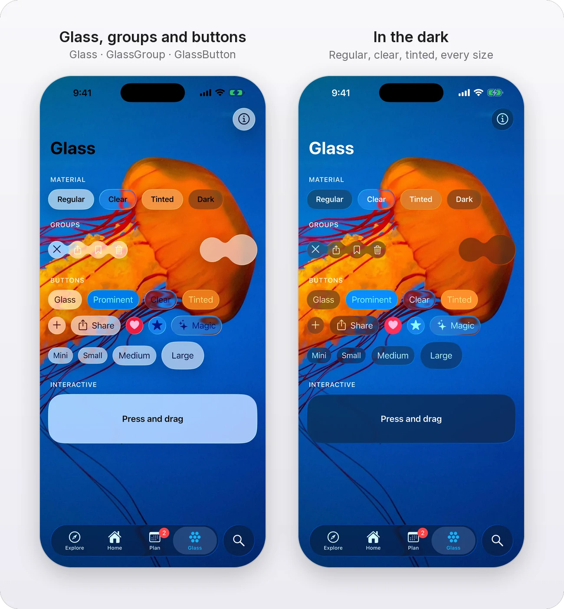

`GlassButton` is UIKit's glass button: a label, an icon or both, in UIKit's
four sizes. Its label is vibrant, as UIKit's: it takes the colors of the
glass under it.

```dart
GlassButton(label: 'Done', onPressed: save)
GlassButton(icon: CupertinoIcons.add, onPressed: add)
GlassButton(label: 'Buy', prominent: true, onPressed: buy)            // filled with tint
GlassButton(label: 'Share', style: GlassStyle.clear, onPressed: share)
GlassButton(label: 'Book', size: GlassButtonSize.large, onPressed: book)
```

### Controls

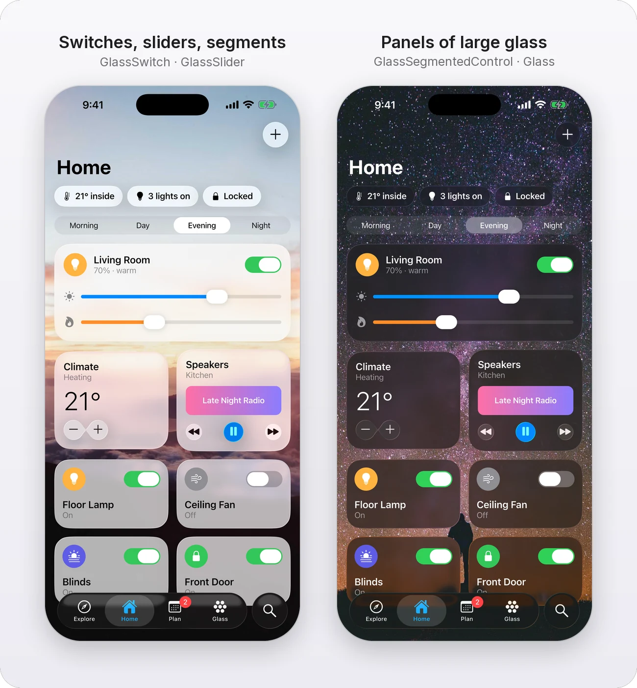

The switch's and slider's thumbs, and the segmented control's selection,
are the tab bar's liquid lens. They lift under the finger and follow it, with
UIKit's sizes, colors and springs.

```dart
GlassSwitch(value: on, onChanged: (v) => setState(() => on = v))
GlassSlider(value: volume, onChanged: (v) => setState(() => volume = v))
GlassSegmentedControl<int>(
  children: {0: Text('Day'), 1: Text('Week'), 2: Text('Month')},
  groupValue: span,
  onValueChanged: (v) => setState(() => span = v),
)
```

### Tab bar

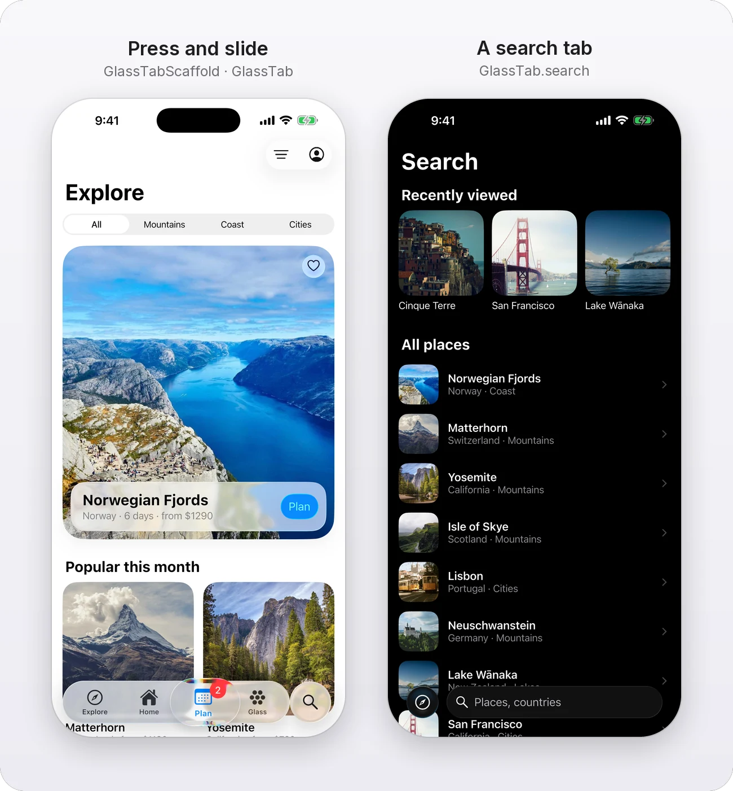

`GlassTabScaffold` gives you the bar, the pages and the navigation. Press
anywhere on the bar and the selection lifts into a clear lens that follows
your finger. Slide it across the tabs and let go to select one.

- **The bar floats over your pages.** It sizes itself as UIKit's does:
  only as wide as up to three tabs need, and the full width with more.
- **Each tab keeps its page and has its own navigator.** `Navigator.push`
  stays inside the tab, and tapping the selected tab again returns to its
  first page.
- **Your pages see the bar** in `MediaQuery.padding`.
- **iOS 26's extras:** a search tab (`GlassTab.search`), a bottom
  `accessory`, and `minimizeOnScroll`.
- **Right to left:** in an RTL `Directionality` the tabs mirror as UIKit
  mirrors them.

`GlassTabBar` is the bar on its own, for apps that manage their own pages
or use a router such as go_router's `StatefulShellRoute`.

<details>
<summary><b>Customize the tab bar</b>: colors, badges, gradients, search, accessory and every option</summary>

<br>

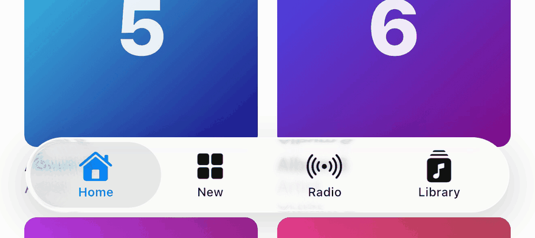

#### Colors and badges

```dart
GlassTabScaffold(
  selectedColor: CupertinoColors.systemPink,
  tabs: [
    GlassTab(icon: CupertinoIcons.house_fill, label: 'Home', page: HomePage()),
    GlassTab(icon: CupertinoIcons.bell_fill, label: 'Alerts', badge: '3', page: AlertsPage()),
  ],
)
```

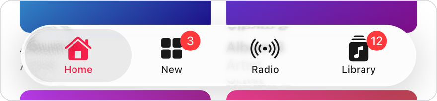

The selected color is mixed with the glass below it, as
`UITabBar.tintColor` is. The other tabs take their colors from the glass;
set `unselectedColor` to override them.

#### Glass colors, at rest and in motion

```dart
GlassTabScaffold(
  selectedColor: CupertinoColors.systemIndigo,
  indicatorColor: Color(0x4D5E5CE6), // the selection at rest
  lensColor: Color(0x99FF2D55),      // the lens, while it moves
  tabs: [...],
)
```

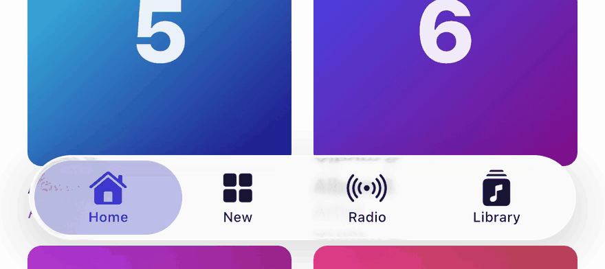

#### Decorations: gradients and shadows

`glass`, `indicator` and `lens` take a `GlassDecoration`, which works like
a `BoxDecoration`. `GlassFill.tint` (the default) colors the glass as iOS
does. `GlassFill.paint` lays the color over the blur exactly as given, to
match a brand.

```dart
GlassTabScaffold(
  brightness: Brightness.dark,
  adaptive: false,
  barPadding: EdgeInsets.all(8),
  glass: GlassDecoration(
    color: Color(0xC21C1C24),
    fill: GlassFill.paint,
    shadows: [BoxShadow(color: Color(0x33000000), offset: Offset(0, 4), blurRadius: 16)],
  ),
  indicator: GlassDecoration(
    gradient: LinearGradient(colors: [Color(0xFF5E5CE6), Color(0xFFBF5AF2)]),
    fill: GlassFill.paint,
  ),
  tabs: [...],
)
```

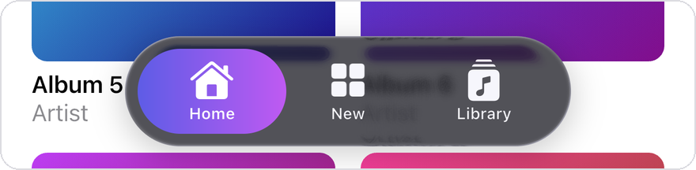

#### Search tab, accessory and minimizing

```dart
GlassTabScaffold(
  minimizeOnScroll: true,              // collapse as a page scrolls down
  accessory: Text('Now Playing'),      // a glass capsule above the bar
  tabs: [
    GlassTab(icon: CupertinoIcons.house_fill, label: 'Home', page: HomePage()),
    GlassTab.search(                   // its own circle at the end,
      controller: searchText,          // and a search field when selected
      page: SearchPage(searchText),
    ),
  ],
)
```

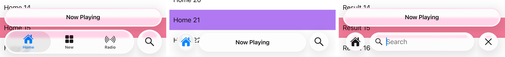

#### All options

| On `GlassTab` | |
|---|---|
| `icon`, `selectedIcon` | `IconData`, or any widget with `GlassTab.custom` (SVG, image); `tintIcon: false` keeps its own colors |
| `label` | under the icon, and read by screen readers |
| `badge` | a count or short word on the icon |
| `color` | this tab's selected color |
| `page` | the tab's first page |
| `GlassTab.search(page:)` | a search tab in its own circle; with `controller` (and `placeholder`, `onChanged`, `onSubmitted`) it opens into a search field |

| On `GlassTabScaffold` | |
|---|---|
| `selectedColor`, `unselectedColor`, `badgeColor` | the tabs' and badges' colors |
| `glassColor`, `indicatorColor`, `lensColor` | tint the bar, the selection at rest, and the lens |
| `glass`, `indicator`, `lens` | `GlassDecoration`: color or gradient, fill, shadows, inner shadows |
| `brightness`, `adaptive` | force light or dark glass; whether it adapts to the content |
| `labelStyle` | merged into the labels' style |
| `barPadding`, `barMargin` | space inside the bar (UIKit: 4pt) and around it (UIKit: 21pt) |
| `backgroundColor` | painted behind the pages |
| `accessory`, `minimizeOnScroll` | a glass capsule above the bar; collapse it on scroll |
| `reduceTransparency` | draw the glass as iOS's Reduce Transparency does |
| `initialIndex`, `onTabChanged`, `controller` | the selected tab |

</details>

### Navigation bars and toolbars

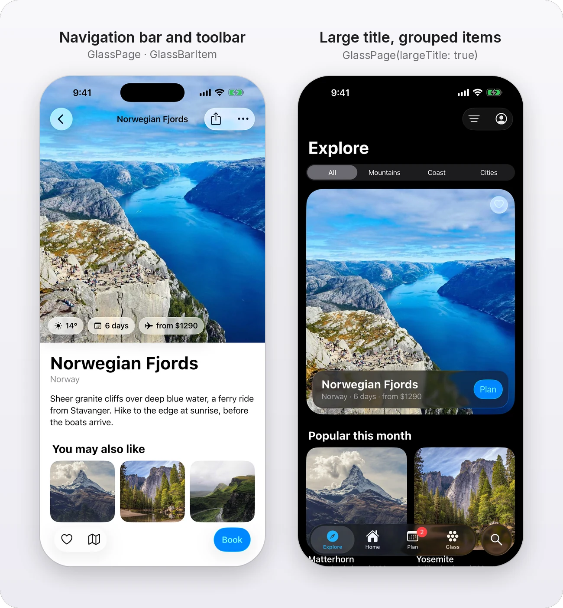

`GlassPage` puts UIKit's bars over a page: a navigation bar of glass at the
top, and a toolbar (or a search field) at the bottom. Content scrolls under
them, softened by UIKit's scroll-edge effect. Icons side by side share one
capsule, and a label or a prominent item gets its own. Between two
`GlassPage`s, a push or a pop morphs the bars as UIKit does. Holding the
back button lists the pages under it.

```dart
GlassPage(
  title: 'Albums',
  largeTitle: true,
  onBack: () => Navigator.pop(context),
  actions: [GlassBarItem(icon: CupertinoIcons.add, onPressed: add)],
  toolbar: [
    GlassBarItem(icon: CupertinoIcons.trash, onPressed: delete),
    GlassBarItem.space(),
    GlassBarItem(label: 'Done', prominent: true, onPressed: done),
  ],
  child: ListView(children: rows),
)
```

### Menus

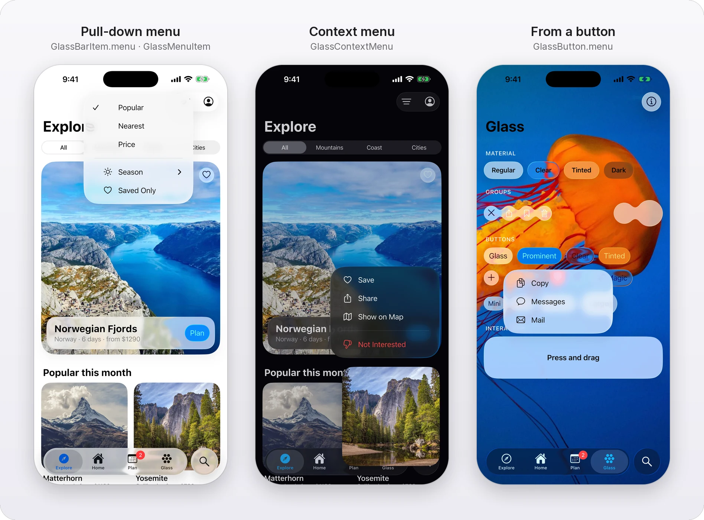

A touch on a `GlassButton` or a `GlassBarItem` with a `menu` grows a
platter of glass out of it, with UIKit's liquid morph. Its rows can have
icons, checkmarks, dividers, destructive items and submenus. A finger can
also slide from the button onto a row and lift to choose it.
`GlassContextMenu` lifts its child over the dimmed screen after a long press
and opens its menu beside it.

```dart
GlassButton(
  label: 'Sort',
  icon: CupertinoIcons.arrow_up_arrow_down,
  menu: [
    GlassMenuItem(label: 'Name', checked: sort == 'Name', onPressed: () => sortBy('Name')),
    GlassMenuItem(label: 'Date', checked: sort == 'Date', onPressed: () => sortBy('Date')),
    GlassMenuItem.divider(),
    GlassMenuItem.submenu(label: 'Show', items: [...]),
    GlassMenuItem(label: 'Delete All', icon: CupertinoIcons.trash, destructive: true, onPressed: clear),
  ],
)

GlassContextMenu(
  items: [
    GlassMenuItem(label: 'Share', icon: CupertinoIcons.share, onPressed: share),
    GlassMenuItem(label: 'Delete', icon: CupertinoIcons.trash, destructive: true, onPressed: delete),
  ],
  child: photo,
)
```

### Date picker and edit menu

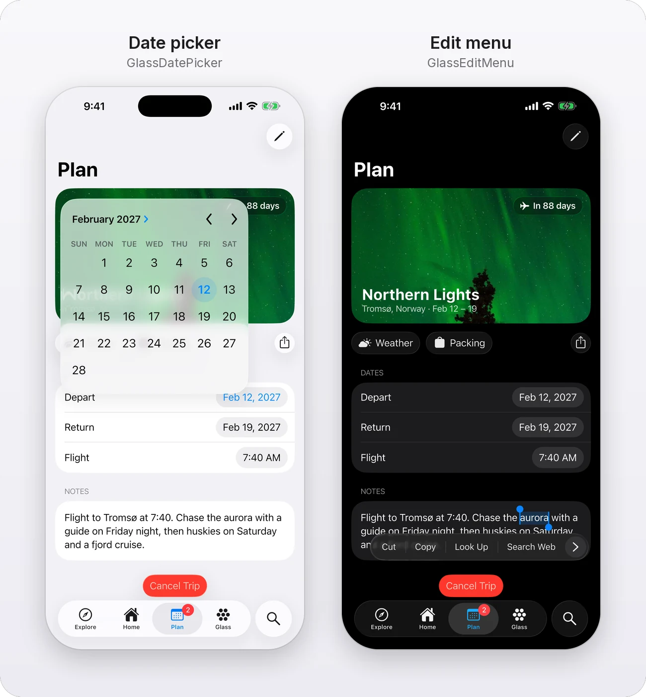

`GlassDatePicker` shows the date, the time or both on gray capsules. A tap
opens UIKit's calendar (with month and year wheels) or its time wheels on a
platter of glass. `GlassEditMenu` is UIKit's edit menu: a row of actions on
a capsule of glass by the selection. Actions that don't fit give way to a
chevron that opens the full menu.

```dart
GlassDatePicker(
  value: date,
  mode: GlassDatePickerMode.dateAndTime,
  onChanged: (d) => setState(() => date = d),
)

CupertinoTextField(contextMenuBuilder: GlassEditMenu.builder)
```

### Sheets, alerts and popovers

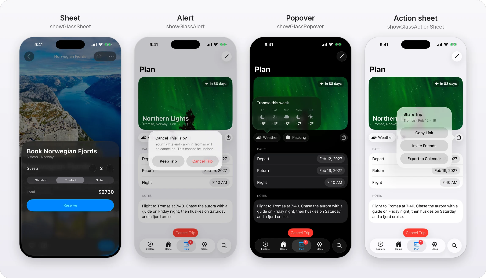

```dart
// A sheet: glass at its medium detent, opaque at its large one.
showGlassSheet(
  context: context,
  detents: [GlassSheetDetent.medium, GlassSheetDetent.large],
  builder: (context) => BookingForm(),
);

// An alert; the future completes with the action chosen.
final GlassAlertAction? choice = await showGlassAlert(
  context: context,
  title: 'Cancel This Trip?',
  message: 'This cannot be undone.',
  actions: [
    GlassAlertAction(label: 'Keep Trip', cancel: true),
    GlassAlertAction(label: 'Cancel Trip', destructive: true),
  ],
);

// A popover by its source: pass the context of the widget it points at.
Builder(
  builder: (source) => GlassButton(
    label: 'Weather',
    onPressed: () => showGlassPopover(context: source, builder: (_) => Forecast()),
  ),
)
```

- **Sheets** rise over the dimmed screen to their smallest detent
  (`medium`, `large` or `GlassSheetDetent.height(...)`). Below the large
  detent they are panels of glass held off the screen's edges. Drag one
  between detents, drag it down or tap outside to dismiss it.
- **Alerts** grow in over the dimmed screen and take optional text fields
  (`GlassAlertTextField`). Their actions sit side by side when there are
  two, and stacked otherwise.
- **Action sheets** (`showGlassActionSheet`) without a `source` are shown
  like alerts, as on iOS 26.5. With a `source`, they become a popover by it
  and a tap outside cancels them.
- **Popovers** pick the side UIKit picks, size themselves to their content
  and grow out of their arrow.

## Measured against UIKit

Liquidum was built in stages, and each was compared with UIKit before the
next began. Each comparison used the same screen, the same backgrounds and
the same touches. UIKit's own layers and filters were read in the
simulator, and recordings were compared frame by frame.

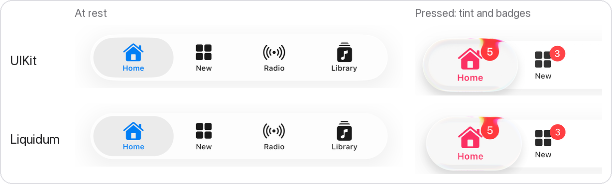

| Stage | What was measured | Evidence |
|---|---|---|
| Tab bar | The lens, the optics, lighting and adaptive appearance. At rest the two bars differ by about one level out of 255 | [`doc/comparison/stage1`](doc/comparison/stage1) to [`stage6`](doc/comparison/stage6), [`refinements`](doc/comparison/refinements) |
| Glass | UIKit's inputs from 30 to 400pt, over the same backdrops | [`glass-widgets/stage1`](doc/comparison/glass-widgets/stage1) |
| Groups | The union and its neck, over 25 layouts | [`glass-widgets/stage2`](doc/comparison/glass-widgets/stage2) |
| Buttons | Sizes, vibrant labels and the press | [`glass-widgets/stage3`](doc/comparison/glass-widgets/stage3) |
| Switch, slider, segmented control | At rest and frame by frame under the finger | [`glass-widgets/stage4`](doc/comparison/glass-widgets/stage4) |
| Bars | Metrics, grouping, the scroll-edge effect, light and dark | [`glass-widgets/stage5`](doc/comparison/glass-widgets/stage5) |
| Menus and morphs | The liquid morph fitted to UIKit's frames, context and edit menus, the date picker | [`glass-widgets/stage6`](doc/comparison/glass-widgets/stage6) |
| Presentations | Sheet detents within 0.05pt, an alert identical to UIKit's but for the status bar's clock, popover placement and shadow | [`glass-widgets/stage7`](doc/comparison/glass-widgets/stage7) |

Each folder holds the measurements, the method and what still differs.

## Platforms

| Platform | Renderer | Status |
|---|---|---|
| iOS | Impeller (Metal) | Measured against UIKit on iOS 26.5 |
| Android | Impeller (Vulkan, OpenGL ES) | Supported, with the same glass and shaders |
| Other renderers | Skia, web | Plain frosted glass, without refraction |

## Accessibility

| Setting | What Liquidum does |
|---|---|
| Increase Contrast | The tab bar's glass is filled nearly white, and its selected color darkens as UIKit's does |
| Reduce Motion | The tab bar's selection slides under the finger without lifting into a lens, and nothing swells or flexes |
| Reduce Transparency | Flutter doesn't report it: pass `reduceTransparency: true` (for example from a platform channel reading `UIAccessibility.isReduceTransparencyEnabled`) |
| Screen readers | Tabs, buttons, bar items and controls carry semantic labels and actions |
| Right to left | The tab bar, `GlassPage`'s bars and the controls mirror as UIKit's do |

## Examples

The [`example`](example) folder holds these apps. Run them from it:

| Command | What it is |
|---|---|
| `flutter run -t lib/showcase.dart` | **The showcase:** a travel and home app that uses every widget, light and dark (the images above) |
| `flutter run` | The tab scaffold with four tabs, about 40 lines |
| `flutter run -t lib/playground.dart` | Change colors, badges, appearance and direction live. On iOS, compare with Apple's own tab bar over the same content |
| `flutter run -t lib/features.dart` | A search tab, an accessory and the bar minimizing as you scroll |
| `flutter run -t lib/comparison.dart` | The harness used to compare the tab bar with UIKit |
| `flutter run -t lib/bars_comparison.dart` | The harness used to compare the bars with UIKit |
| `flutter run -t lib/menus_comparison.dart` | The harness used to compare menus and presentations with UIKit |

Judge motion in profile or release mode: debug builds are much slower. The
showcase's photos are from [Unsplash](https://unsplash.com)
([credits](example/assets/photos/CREDITS.md)).

## Requirements and limits

- **Impeller is required** for refraction (`ImageFilter.shader`), on iOS and
  on Android. Other renderers get plain frosted glass.
- **Paint glass after the content it floats over**, for example later in a
  `Stack`. The scaffold and `GlassPage` do this for you.
- **Don't wrap glass in an `Opacity`, a `ShaderMask` or another save
  layer.** It has to paint into the root layer to read what is behind it.
- **Keep tab icons static.** The bar draws its tabs from an image of them,
  rendered again whenever they repaint.
- **Reduce Transparency has to be passed in** (see
  [Accessibility](#accessibility)).
- **Not done yet:** light that follows the device's tilt.

## License

Liquidum is open source under the [MIT License](LICENSE): free to use in
personal and commercial apps alike.

Liquidum is an independent project, not affiliated with or endorsed by
Apple Inc. Apple, iOS and UIKit are trademarks of their respective owners.
